# Outpost: Beyond Earth
### NASA International Space Apps Challenge 2027

[](https://www.typescriptlang.org/)
[](https://react.dev/)
[](https://threejs.org/)
[](https://vitest.dev/)
[](https://data.nasa.gov/)

**Outpost: Beyond Earth** is a realistic aerospace base-building strategy web game engineered for the **NASA International Space Apps Challenge 2027**. Unlike conventional combat strategy games, players face real planetary physics and harsh space environments (episodic Solar Particle Events, 354-hour lunar nights, cryogenic shadowed cold traps, micrometeorite strikes, and interplanetary communication light-delays). 

Every gameplay mechanic is grounded in real NASA mission engineering, accompanied by live formulas and "Why this is real" educational telemetry.

---

## Architecture Diagram

```mermaid
flowchart TD
    subgraph UI ["User Interface Layer (React 19 + TailwindCSS)"]
        MM["Main Menu & Fast Demo Launcher"]
        SS["Season & Level Selector (Moon / Mars)"]
        MP["Mission Planner (Tsiolkovsky & Orbital dv)"]
        LS["Landing Site Selector (LOLA & Neutron Data)"]
        BB["Base Builder View (2D Isometric Canvas Engine)"]
        EP["Engineer's Telemetry & Formula Panel"]
        TT["Technology Tree (TRL 1-9 & Science Points)"]
        MR["Mission Report & Multi-Factor Scoring"]
    end

    subgraph Core ["Aerospace & Simulation Core"]
        ORB["Orbital Physics (Hohmann, Tsiolkovsky, Solar Flux, Light-Time)"]
        ECON["Resource Simulation (Power, O2, H2O, Food, Ore, Propellant)"]
        HAZ["Hazard Engine (DONKI SPEs, Micrometeorites, Thermal Night)"]
        DOS["Dosimetry Engine (GCR, SPE Proton Flux, Regolith HVL Berms)"]
        AUD["Procedural Web Audio Synthesizer (Zero Assets)"]
    end

    subgraph State ["Global State Machine (Zustand)"]
        STORE["useGameStore (State Machine, Timers, Modules, Telemetry)"]
    end

    subgraph Data ["Cached NASA Static Datasets (/src/data)"]
        D1[("rockets.json<br/>SLS, Starship, Falcon Heavy")]
        D2[("landingSites.json<br/>LOLA Altimetry & Diviner")]
        D3[("modules.json<br/>NASA STMD & Glenn Baseline")]
        D4[("hazards.json<br/>DONKI Solar Storms & SOHO")]
        D5[("technologies.json<br/>NASA Technology Taxonomy")]
        D6[("season1_moon.json<br/>Artemis Base Camp 10 Levels")]
        D7[("season2_mars.json<br/>Jezero Delta & MOXIE")]
    end

    Data --> STORE
    STORE <--> Core
    STORE <--> UI
    Core --> UI
```



---

## Real Physics vs Gameplay Simplifications

| Aerospace Physics Domain | Real Physics Model | Game Implementation | Simplification for Gameplay |
| :--- | :--- | :--- | :--- |
| **Orbital Transfer** | Elliptical Keplerian orbit perturbed by multi-body n-body gravity, solar radiation pressure, and non-coplanar orbital inclination. | Coplanar Hohmann Transfer Orbit: $t_{\text{transfer}} = \pi \sqrt{a^3 / \mu_{\text{sun}}}$; $\Delta v$ from vis-viva equation. | Circular, coplanar planetary orbits assumed; planetary gravity assists and orbital plane inclinations omitted. |
| **Rocket Propulsion** | Multi-stage Tsiolkovsky equation with atmospheric backpressure nozzle expansion losses ($I_{\text{sp}}(p)$) and gravity drag losses. | Single/Upper-stage Tsiolkovsky rocket equation: $\Delta v = I_{\text{sp}} \cdot g_0 \cdot \ln(m_0 / m_f)$. | Gravity and atmospheric drag approximated into standard NASA $\Delta v$ budget margins (5.61 km/s Moon, 9.40 km/s Mars). Lander descent stage lumped into net payload. |
| **Solar Irradiance** | Inverse-square solar irradiance $S(r) = S_0 / r^2$ ($1361\text{ W/m}^2$ at 1 AU; $586\text{ W/m}^2$ at Mars). | Exact inverse-square law applied to solar arrays based on body distance and local terrain slope/illumination. | Atmospheric Rayleigh scattering and dynamic diurnal dust storm optical depth ($\tau$) simplified into bulk solar generation multipliers. |
| **Day / Night Illumination** | 3D horizon raytracing against 100m/px LRO LOLA digital elevation models (DEM) accounting for lunar precession and terrain occlusion. | Analytical synodic orbital day/night function: 354.35h continuous equatorial night; polar crater peaks modeled with 88-92% annual light and periodic shadow dips. | Eliminates 400 MB DEM downloads for 100% offline, instant 60 FPS mobile and desktop performance. |
| **Space Weather & SPEs** | Relativistic shock-accelerated protons (10-100 MeV) traveling along Parker spiral magnetic field lines arriving in 30-120 min; CME plasma arriving in 15-48h. | Two-phase state machine: 12-24 hour advance warning phase (coronagraph detection) followed by 24-48 hour active particle storm phase. | Advance warning window standardized to allow player tactical mitigation (sintering berms, sheltering crew). |
| **Radiation Dosimetry & Shielding** | Full Monte Carlo ion transport (GEANT4 / HZETRN) modeling primary proton stopping power, nuclear fragmentation, spallation neutron cascades, and Bremsstrahlung. | Exponential Half-Value Layer (HVL) model: $I = I_0 \cdot 2^{-x / \text{HVL}}$ with $\text{HVL} = 18\text{ cm}$ for compacted lunar regolith ($\rho \approx 1.6\text{ g/cm}^3$). | Secondary neutron spallation and heavy ion ($Z \ge 26$) fragmentation lumped into bulk effective regolith attenuation coefficient. |
| **Life Support (ECLSS)** | Dynamic mass-balance chemical loop: Bosch/Sabatier $\text{CO}_2$ methanation, trace contaminant catalytic oxidation, and vacuum membrane distillation. | NASA Human Integration Design Handbook (HIDH Table 7.2-1) metabolic consumption: 0.84 kg $\text{O}_2$/crew-day, 2.5 kg drinking $\text{H}_2\text{O}$/crew-day, 0.62 kg food/crew-day with 93% closed-loop recovery. | Discretized fixed-timestep numerical integration. Metabolic rates are constant without modeling astronaut exertion spikes or EVA metabolic surges. |
| **Communications Delay** | Light-time delay $t = d/c$ varies continuously between 3.0 min (opposition) and 22.3 min (conjunction) for Earth-Mars comms. | Explicit light-time communication badge and command transmission delay simulated based on current orbital epoch. | Telemetry packets are visual indicators and command buffers rather than preventing pause/inspect controls. |

---

## Data Sources & Provenance

All game data is statically cached in `/src/data` for **100% offline gameplay**. Zero external network requests are made at runtime.

| Dataset / File | Data Origin | Mission / Instrument Citation | Key Parameters Used |
| :--- | :--- | :--- | :--- |
| `rockets.json` | `factsheet-manual` | NASA SLS Fact Sheet & SpaceX Starship User Guide | Dry mass, wet mass, vacuum $I_{\text{sp}}$, fairing volume, payload capacity to TLI/TMI |
| `landingSites.json` | `factsheet-manual` | NASA LRO LOLA Altimeter & Lunar Prospector Spectrometer | Latitude, longitude, elevation, annual illumination fraction, subsurface ice wt% |
| `modules.json` | `factsheet-manual` | NASA STMD Kilopower KRUSTY, Vertical Solar Arrays (VSAT), and ISS ECLSS | Power generation/draw, mass, cost, $\text{O}_2$ extraction rate, degradation hours |
| `hazards.json` | `api` & `factsheet-manual` | NASA Space Weather Database (DONKI) API & NOAA Space Weather Prediction | May 2024 Solar Storm (SEP `2024-05-10T12:59:00-SEP-001`), proton flux, CME speeds |
| `technologies.json` | `factsheet-manual` | NASA Technology Readiness Levels (TRL) & NASA Space Technology Taxonomy | Technology tree tiers, science point costs, prerequisite dependency graphs |
| `season1_moon.json` | `factsheet-manual` | NASA Artemis Plan (NASA SP-2020-5009) | 10 playable lunar levels: power, ice mining, MRE oxygen, berms, propellant depots |
| `season2_mars.json` | `factsheet-manual` | NASA Mars 2020 Perseverance / MOXIE Team (Hecht et al., 2022) | Playable Jezero Delta level: thin $\text{CO}_2$ atmosphere, MOXIE SOXE cell, light delay |

---

## Features & Content

- **10-Level Moon Campaign (Season 1)**:
  - Level 1: First Footsteps (Interactive Guided Tutorial)
  - Level 2: The 354-Hour Lunar Night (Equatorial Mare Tranquillitatis survival)
  - Level 3: Mining the Shadows (Cryogenic water ice extraction at Shackleton cold trap)
  - Level 4: Breath of the Regolith (Molten Regolith Electrolysis $\text{O}_2$ production)
  - Level 5: The Radiation Berm (Microwave 3D sintering & space weather survival)
  - Level 6: The Volatiles Rover Network (Deep crater rover sorties $\ge 2000\text{ m}$)
  - Level 7: Fuel Depot of the South Pole (Cryogenic zero-boil-off $\text{LOX/LH}_2$ storage)
  - Level 8: The Century Storm (Major extreme Solar Particle Event & bunker sheltering)
  - Level 9: Gateway Supply Mission (Orbital ascent propellant stockpiling)
  - Level 10: Expedition Artemis Base Camp (4 astronauts sustained for 180 days)
- **Season 2 Mars (Playable Preview)**:
  - Mars Level 1: Jezero Delta & MOXIE Oxygen extraction with 14.2 min light delay
  - Levels 2–10 fully scaffolded in JSON
- **Pure Web Audio Synthesizer**: Procedural acoustic synthesis for rocket launches, thruster burns, building placement clinks, emergency storm sirens, and error cues without external audio assets.
- **Bilingual Interface**: Full English and Bengali (বাংলা) localization across every HUD, panel, and modal.
- **Engineer's Panel**: Interactive telemetry drawer displaying governing physics formulas, live numbers, NASA citations, and "Simplified for gameplay" notes.

---

## Fast 2-Minute Demo Run

For judges, evaluators, and the NASA Space Apps Challenge video presentation:
1. Click the prominent **⚡ 2-MIN NASA DEMO RUN** button on the Main Menu, or the **⚡ Demo** button on the top HUD.
2. Alternatively, open the game with the URL query parameter:
   ```
   http://localhost:5173/?demo=true
   ```
This instantly initializes a thriving mid-game lunar settlement:
- Active hybrid Kilopower fission + VSAT solar microgrid ($+12.8\text{ kW}$ surplus)
- Sintered 54 cm regolith radiation berm
- Astronauts safely deployed in bunker shelter
- Active early-warning countdown for a Solar Particle Event (CME proton storm)
- Active prospecting rover traversing Shackleton basin cold trap ($2,850\text{ m}$ traversed, $7.8\%$ cryo-ice detected)
- 4,600 kg cryogenic propellant liquefied in storage
- Passing score across all 4 primary mission objectives

---

## Getting Started

### Prerequisites
- Node.js 18+ (tested on Node.js 22 LTS)
- npm 9+

### Installation & Development
```bash
# Clone the repository
git clone https://github.com/your-username/outpost-beyond-earth.git
cd outpost-beyond-earth

# Install dependencies
npm install

# Start local development server
npm run dev
```
Open [http://localhost:5173](http://localhost:5173) in your browser.

### Running Test Suite
The game includes 78 automated Vitest unit tests covering Hohmann orbital mechanics, Tsiolkovsky propellant mass, radiation dosimetry, fixed-timestep life support, tech tree prerequisites, and headless campaign progression (all 10 Moon levels + Mars Level 1 with both scripted wins and loss scenarios):
```bash
npm test
```

### Production Build
```bash
npm run build
```
Produces an optimized static bundle in `/dist` deployable to Vercel, Netlify, or GitHub Pages.

---

## Deploy to Vercel

```bash
npm install -g vercel
vercel deploy --prod
```

---

## NASA Space Apps Challenge 2027 Submission
Developed for the **NASA International Space Apps Challenge 2027**.
Built with real data from NASA LRO, LOLA, CRaTER, DONKI, SOHO, Perseverance MOXIE, and Glenn Research Center.
